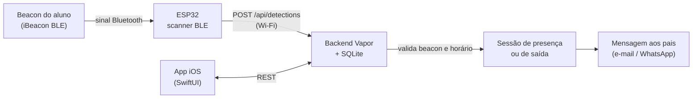

<div align="center">

# Presença Escolar com Beacons

**Os pais recebem um aviso quando o filho chega à escola e quando sai, sem ninguém fazer chamada.**

Sistema IoT completo: hardware ESP32, backend em Swift (Vapor) e aplicação iOS em SwiftUI.


</div>

<!-- Adiciona aqui uma foto do ESP32 com o beacon e uma captura do dashboard da app. -->

---

## O problema

Muitos pais querem saber se o filho chegou bem à escola, mas confirmar isso depende de chamadas manuais ou de mensagens da secretaria. Este projeto automatiza o processo: cada aluno leva um beacon Bluetooth (iBeacon), um ESP32 à entrada da escola deteta-o e o sistema avisa os responsáveis.

## Como funciona



1. **Cadastro:** na app, a escola regista os beacons e associa cada um a um aluno.
2. **Deteção:** o ESP32 procura iBeacons próximos e envia cada deteção ao backend.
3. **Validação:** o backend só aceita beacons registados e verifica se a deteção cai na janela de entrada ou de saída.
4. **Notificação:** é gerada uma mensagem a partir de modelos configuráveis (presença, falta, saída, não saiu).
5. **Acompanhamento:** a app mostra o dashboard do dia, o histórico e as configurações.

## Funcionalidades

- Cadastro de beacons e de alunos associados a beacons
- Deteção automática, que ignora beacons não registados
- Janelas de horário configuráveis para entrada e saída
- Modelos de mensagem personalizáveis para cada situação
- Histórico de sessões e registos de presença
- Dashboard com o estado do dia e da ligação ao servidor
- Deteção também pelo próprio iPhone, com regiões de beacon do CoreLocation

## Destaques técnicos

- **Três camadas a falar entre si:** firmware em C++ (Arduino), API REST em Swift no servidor e cliente iOS. O mesmo idioma (Swift) no backend e na app.
- **Backend com Vapor 4 + Fluent:** controllers por recurso, modelos com migrations e base de dados SQLite criada automaticamente.
- **Regras de negócio no servidor:** criação de sessões diárias, prevenção de registos duplicados e formatação das mensagens com os dados do aluno e a hora.
- **Leitura de iBeacon no ESP32:** interpretação dos dados de fabricante do pacote BLE para extrair UUID, major e minor.
- **Logs estruturados:** `os.Logger` na app, por categoria (beacons, presença, alunos), e o logger do Vapor no servidor.
- **App em MVVM:** um `AttendanceManager` coordena os ViewModels de beacons, alunos, dashboard, histórico e configurações. A comunicação com a API fica isolada no `APIService`.

## Stack

| Camada | Tecnologia |
| --- | --- |
| App iOS | SwiftUI, CoreLocation, MVVM |
| Backend | Swift, Vapor 4, Fluent, Leaf |
| Base de dados | SQLite |
| Hardware | ESP32 (BLE + Wi-Fi), iBeacons |
| Firmware | C++ / Arduino IDE |

## API

| Método | Rota | Descrição |
| --- | --- | --- |
| `GET` `POST` | `/api/beacons` | Listar e criar beacons |
| `GET` `PUT` `DELETE` | `/api/beacons/:id` | Consultar, atualizar e apagar um beacon |
| `GET` `POST` | `/api/students` | Listar e criar alunos |
| `GET` `PUT` `DELETE` | `/api/students/:id` | Consultar, atualizar e apagar um aluno |
| `POST` | `/api/detections` | Registar uma deteção (chamada pelo ESP32) |
| `GET` | `/api/attendance/sessions` | Listar sessões |
| `GET` | `/api/attendance/sessions/:id` | Detalhes de uma sessão |
| `GET` | `/api/attendance/records` | Listar registos |
| `GET` `PUT` | `/api/attendance/settings` | Consultar e alterar horários e mensagens |

## Estrutura

```
Pi_Japao/
├── docs/                 # Guias de configuração e arquitetura
└── PI_Japao/
    ├── Backend/          # API em Vapor (controllers, models, migrations, services)
    ├── ESP32/            # Firmware do scanner BLE
    └── PI_Japao/         # App iOS
        ├── Models/
        ├── Views/
        ├── ViewModels/
        ├── Services/     # APIService e BeaconScannerService
        └── Resources/    # Tema, layout adaptativo e componentes
```

## Como executar

**Requisitos:** macOS 13+, Xcode 26+ (a app usa iOS 26), Arduino IDE com suporte ao ESP32, um ESP32 e pelo menos um beacon (ou um telemóvel a emitir iBeacon).

### 1. Backend

```bash
git clone https://github.com/devmiqsaldh/Pi_Japao.git
cd Pi_Japao/PI_Japao/Backend
swift run
```

O servidor arranca em `http://localhost:8080` e cria o ficheiro `attendance.db` na primeira execução.

### 2. App iOS

1. Abre `PI_Japao/PI_Japao.xcodeproj` no Xcode.
2. Em `Services/APIService.swift`, aponta a URL para o backend. Num dispositivo físico, usa o IP local do computador em vez de `localhost`.
3. Executa no simulador ou no iPhone.

### 3. ESP32

1. Abre `PI_Japao/ESP32/esp32_beacon_scanner.ino` no Arduino IDE.
2. Preenche o nome e a senha da rede Wi-Fi e a URL do backend (IP local do computador).
3. Carrega o código para o ESP32 e acompanha as deteções no Monitor Série.

## Documentação

- [Guia completo de configuração](docs/configuracao.md)
- [Arquitetura da app](docs/arquitetura.md)
- [Como registar beacons e alunos](docs/cadastro-beacons.md)
- [Configuração do ESP32](docs/esp32.md)
- [Envio de mensagens (e-mail e WhatsApp)](docs/mensagens.md)
- [Configuração do Xcode](docs/xcode.md)
- [Backend](PI_Japao/Backend/README.md)

## Estado atual e próximos passos

- [x] Fluxo completo beacon → ESP32 → backend → app
- [x] Sessões, histórico e configurações
- [ ] Envio real das mensagens (hoje o envio por e-mail e WhatsApp é simulado e aparece no log do servidor)
- [ ] Autenticação na API
- [ ] Notificações push para os pais

## Autor

**Miqueias Saldanha**: desenvolvedor iOS, Apple Developer Academy | Mackenzie

[](https://github.com/devmiqsaldh)

## Licença

Distribuído sob a licença MIT. Consulta o ficheiro [LICENSE](LICENSE).
